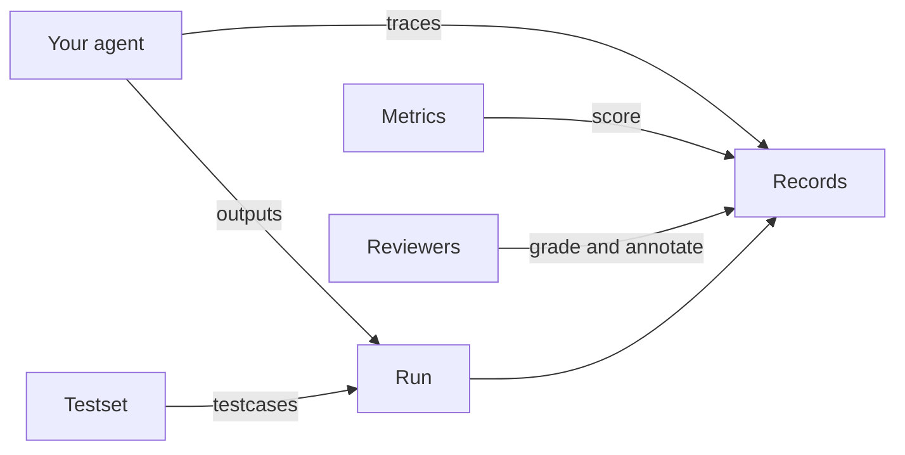

Everything in Scorecard lives in a **project**. Your agent's activity arrives as **records**, either from traces or from evaluation code. **Metrics** score those records, and people **review** them. **Testsets** and **runs** let you repeat the same checks on every new version of your agent.

## Glossary

| Term | What it is | Also called |
| --- | --- | --- |
| **Organization** | Your team's workspace. It holds members, API keys, and model provider keys. Each person has the **Admin** or **Member** role. | Workspace, org |
| **Project** | A container for one agent or use case: its records, testsets, metrics, runs, and systems. Project IDs are numeric, for example `314`. | |
| **Trace** | An OpenTelemetry trace of one request to your agent. Each **span** is one step, such as a model call or a tool call. | |
| **Session** | Traces that share a session ID, such as the turns of one conversation. A session becomes one record. | Thread, conversation |
| **Record** | One execution of your agent: inputs, outputs, expected outputs, scores, annotations, tags, and assignees. | Log, result |
| **Testset** | A collection of testcases with a schema that marks each field as an input, an expected output, or metadata. | Dataset |
| **Testcase** | One row in a testset. Its inputs are sent to your agent and its expected outputs are compared to what your agent returns. | Example, item, golden |
| **Metric** | A definition of "good" for one quality, scored by an AI judge, a person, or code. | Evaluator, scorer, grader |
| **Metric group** | A named set of metrics you apply together. | |
| **Metric config** | One version of a metric as attached to a run. Its ID is what you pass to `scores.upsert`. | Metric version |
| **Run** | A batch of records, usually your agent's outputs on one testset, scored with a chosen set of metrics. | Experiment, test run |
| **Score** | One metric's result for one record: a value and the reasoning behind it. | Grade, feedback |
| **System** | The agent or pipeline you're testing, such as "Support agent". A **prompt** is a system whose versions each hold a prompt template and a model. | |
| **System version** | One configuration of a system, such as a model, prompt, and parameters. Tag a run with it to record what produced the scores. | Config, variant |
| **Annotation** | A person's feedback on a record or span: thumbs up or down, a comment, or a highlighted passage. | Comment, label |

## Where records come from

| Source | How it's created | Shown as |
| --- | --- | --- |
| Tracing | Your app sends OpenTelemetry traces. Scorecard turns each trace, or each session, into a record. See [Tracing](/features/tracing). | **Trace** |
| SDK or API | Your code creates a run and adds one record per testcase, usually with `run_and_evaluate`. Runs your GitHub workflow starts count here too. See [Runs](/features/runs). | **API** |
| Kickoff Run | Scorecard runs a [prompt](/features/prompts) over a testset for you. | **Kickoff** |

When an SDK record and a trace carry the same link ID (`scorecard.otel_link_id`), they merge into one record that has both your structured outputs and the full trace. See [Link traces to runs](/features/sdk-tracing).

## How scoring works

- A metric has an **evaluation type** (**AI**, **Human**, or **Heuristic**) and an **output type** (**Boolean**, **Integer (1-5)**, or **Float (0.0-1.0)**).
- When a record is added to a run, Scorecard scores it with every metric on that run. AI and heuristic metrics are scored in the background. Human metrics get a pending score that waits for a reviewer.
- Traced records aren't scored by default. Select them on the [Records](/features/records) page and click **Score Records** to apply metrics, or [score a stream of traces automatically](/features/tracing#score-traces).
- A Boolean score passes when it's `true`. An integer or float score passes when it's at or above the metric's passing threshold.
- Each reviewer's human score is kept separately, so one metric on one record can have several graders.

## Next steps

<CardGroup cols={2}>
  <Card title="Tracing quickstart" icon="activity" href="/intro/tracing-quickstart">
    Send your first trace and score it.
  </Card>
  <Card title="Evaluation quickstart" icon="flask-conical" href="/intro/sdk-quickstart">
    Run your agent on a testset and score the results.
  </Card>
</CardGroup>
